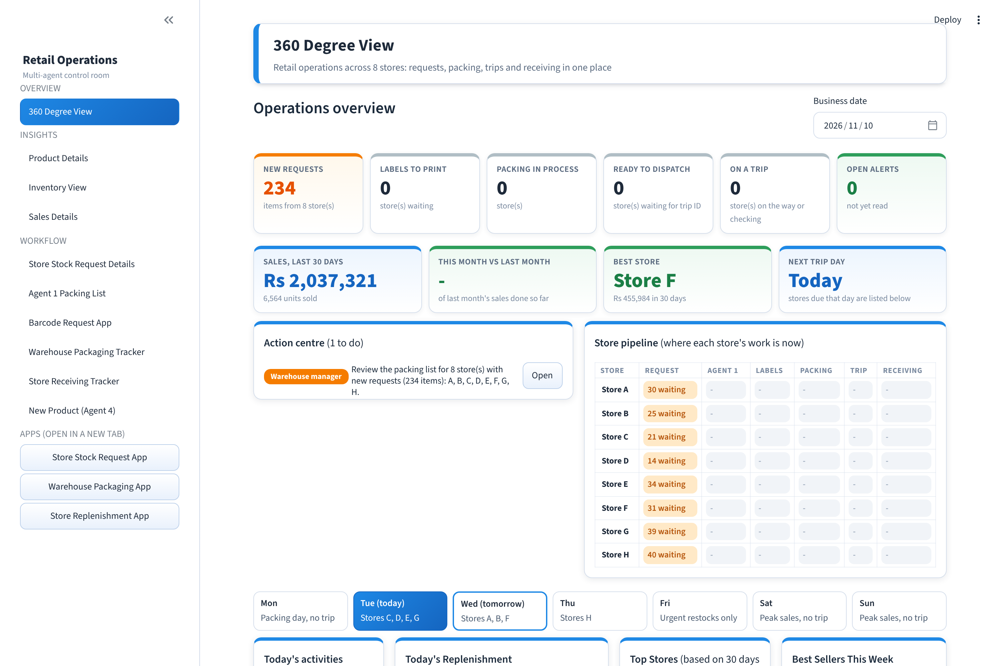
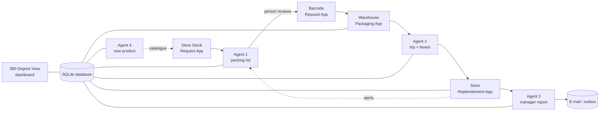
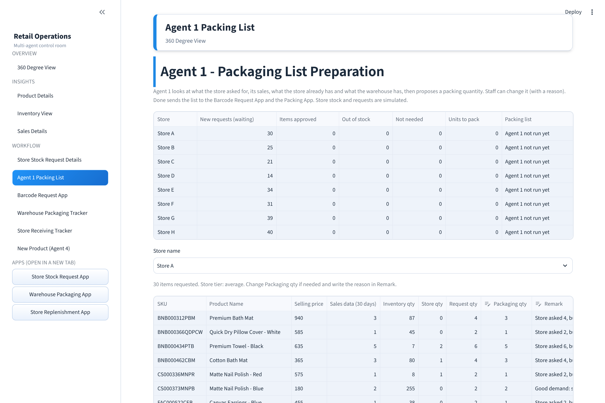
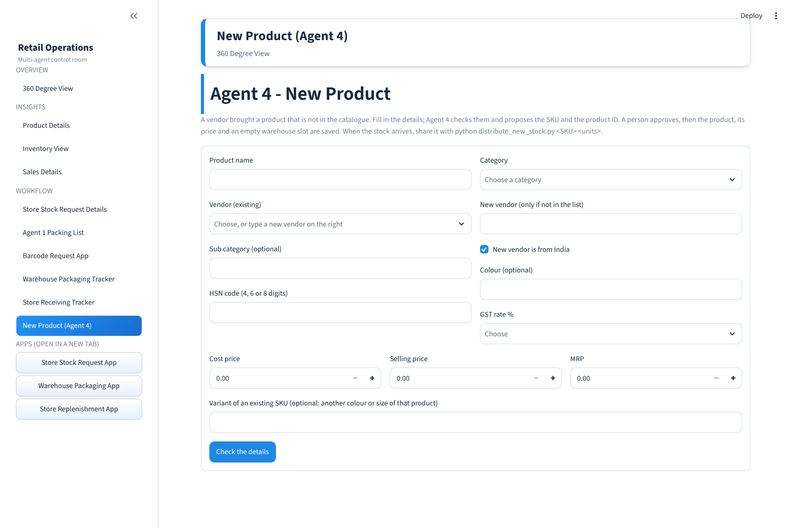

# Retail Multi-Agent Operations System

A LangGraph multi-agent system that runs the replenishment cycle of an 8-store retail business: **store requests → packing list → barcode labels → warehouse packing → delivery trip → store receiving → manager report**. Four agents do the thinking, people approve the important steps, and a control-room dashboard shows where every store is at any moment.



> **About the data (please read).** The project was designed on one month of real retail data (August 2025) from a former employer. **No real data is in this repository.** The stores are called *Store A–H*, and everything you can run from this repo uses a **fully invented demo data set** (`make_demo_data.py`, fixed seed 42). Even in my own version, the vendors, racks, restock requests, store stock and staff names are simulated. To make the dashboard look current, **sales dates are shifted when displayed**: the 30 days of sales are shown as the 30 days ending yesterday (the database itself is never changed).

---

## What it does

| Step | Who | What happens |
|---|---|---|
| 1. Request | Store staff (**Store Stock Request App**) | Pick items, type a quantity (never above the warehouse quantity; zero-stock items show "OS"). |
| 2. Packing list | **Agent 1** + a person | Looks at each store's 30-day sales, its tier (top / average / low), what is already on its shelf and what the warehouse holds, then proposes a quantity with a plain-words reason. A person can edit any number (a reason is required). |
| 3. Labels | Warehouse (**Barcode Request App**) | One barcode label per unit to pack. |
| 4. Packing | Warehouse staff (**Warehouse Packaging App**) | Only *packed* and *damaged-while-packing* are typed in. |
| 5. Trip | **Agent 2** | Verifies each store's list, blocks problem stores, creates one trip ID per delivery day (Tue C/D/E/G, Wed A/B/F, Thu H, Fri urgent only, Mon packing only, no weekend trips), boxes the items and takes the stock out of the warehouse, all in one transaction. |
| 6. Receiving | Store staff (**Store Replenishment App**) | Check each line (received, damaged). Match and Remark are calculated. Many problem lines raise a Notice / Warning / Serious alert for the warehouse. |
| 7. Report | **Agent 3** | Verifies that the numbers add up, calculates the trip performance in code, asks the AI to write a short summary (refused if it contains a number that is not in the data) and e-mails it to the operations head. |
| + New product | **Agent 4** + a person | A vendor brings a new item: the code builds the SKU and product ID, a person approves, everything is saved at once. |



| | |
|---|---|
|  |  |

## Design principles

1. **Code decides, AI only writes.** Quantities, stock, SKUs, trip days and alerts come from plain, tested Python (`allocation.py`, `guardrails.py`). The LLM (Google Gemini, free tier) only writes short notes and summaries, and its text is **rejected** if it contains a number that is not in the data, a link, or is too long. Without an API key the system still works with standard texts.
2. **Human in the loop while the business is young.** Agent 1, Agent 2 and Agent 4 pause (LangGraph `interrupt`) for a person; every edit is stored (agent's number vs the person's number) as future training data.
3. **All or nothing.** Every save (packing list, trip, receipt, new product) is one database transaction.
4. **Stores are rows, not columns.** A new store is one new row; old trips keep their own store list.
5. **Explainable.** Every Agent 1 decision carries a reason in plain words, shown on screen.

### How stock is shared (Agent 1)
* A store needs what it **sold** (30 days), capped by what it asked, unless the request Note explains a high demand.
* A store holding more than its buffer on the shelf (top 28 days, average 14, low 10 days of sales) gets nothing.
* If the warehouse is short, stock is shared by tier weights **top 21 : average 14 : low 9** (e.g. top+average 60/40, top+low 70/30); nobody gets more than it needs and no unit is left unused while a store still needs it.
* New items from a vendor go equally to all stores, or, when there is too little, a minimum pack to the biggest stores first.

## Guardrails and evaluation

There are **20 written rules** (`guardrails.py`), such as: never pack more than the warehouse holds, a trip leaves only on a store's scheduled weekday, a store with a problem cannot go on a trip, the AI cannot invent a number, a new product needs a named approver.

`python evaluate_system.py` pretends to be store staff, warehouse staff and a store checker, sends many simulated orders (some deliberately bad: more than the stock, negative, duplicates, out-of-stock, two stores fighting for the last units, wrong trip days, a trip that fails half-way, a stale proposal) through the real agents on a **copy** of the database, and writes [`evaluation_report.md`](evaluation_report.md). Current result: **142 of 142 checks pass.** The evaluation also found and fixed a real bug: stock that had already left on a trip was counted again on the next packing day.

## Run it yourself

Needs Python 3.11+ (developed on 3.13).

```bash
git clone <this repo> && cd <this repo>
python -m venv .venv
.venv\Scripts\activate            # Windows   (Mac/Linux: source .venv/bin/activate)
pip install -r requirements.txt

python make_demo_data.py          # invents the demo data (data/raw/)
python build_database.py          # builds data/retail.db  (type yes if it asks)
python evaluate_system.py         # optional: runs all 142 checks on a copy
```

Start the four apps, one terminal each:

```bash
streamlit run app.py --server.port 8501                 # 360 Degree View (the control room)
streamlit run store_app.py --server.port 8502           # Store Replenishment App
streamlit run packing_app.py --server.port 8503         # Warehouse Packaging App
streamlit run stock_request_app.py --server.port 8504   # Store Stock Request App
```

Optional (everything works without them): copy `.env.example` to `.env` and add a free Gemini key (`GOOGLE_API_KEY`) for AI-written notes, or Gmail SMTP settings to really send the reports. Without them, e-mails are saved as text files in `outbox/`.

Command-line versions of every step also exist: `python agent1_packing.py`, `agent2_trip.py --date 2026-11-10`, `store_receiving.py`, `agent3_report.py`, `agent4_new_product.py`, `distribute_new_stock.py` and `pipeline.py --auto` (a whole simulated week, with saved checkpoints).

## Project map

| File | Role |
|---|---|
| `schema.sql`, `create_db.py`, `build_database.py` | SQLite schema and one-command rebuild |
| `load_catalog.py`, `load_stores_sales.py`, `simulate_*.py`, `make_demo_data.py` | data cleaning, loading and simulation |
| `allocation.py` | the stock-sharing rules (pure Python, tested by `test_allocation.py`) |
| `guardrails.py`, `evaluate_system.py` | the safety rules and the evidence report |
| `agent1_packing.py`, `agent2_trip.py`, `store_receiving.py`, `agent3_report.py`, `agent4_new_product.py` | the LangGraph agents |
| `pipeline.py` | the whole week as one checkpointed graph |
| `app.py`, `store_app.py`, `packing_app.py`, `stock_request_app.py`, `screen_logic.py`, `ui_theme.py` | the four Streamlit apps and their shared logic and theme |
| `alerts.py`, `notify.py` | problem alerts and e-mail / outbox |

## Limits and next steps
* The data is invented and small; real sales, stock and request volumes would need tuning of the tier weights and buffers (all are constants at the top of `allocation.py`).
* One vehicle, one warehouse; the delivery schedule is a table (`trip_schedule`) you can edit.
* SQLite is right for a single-warehouse pilot; a bigger roll-out would move to a server database.
* Deployment on AWS and a hosted demo are the next step.

## Tech
Python · LangGraph (state graphs, `interrupt`, checkpoints) · SQLite · Streamlit · pandas · Google Gemini (optional, free tier).

## License
MIT, see [LICENSE](LICENSE).
